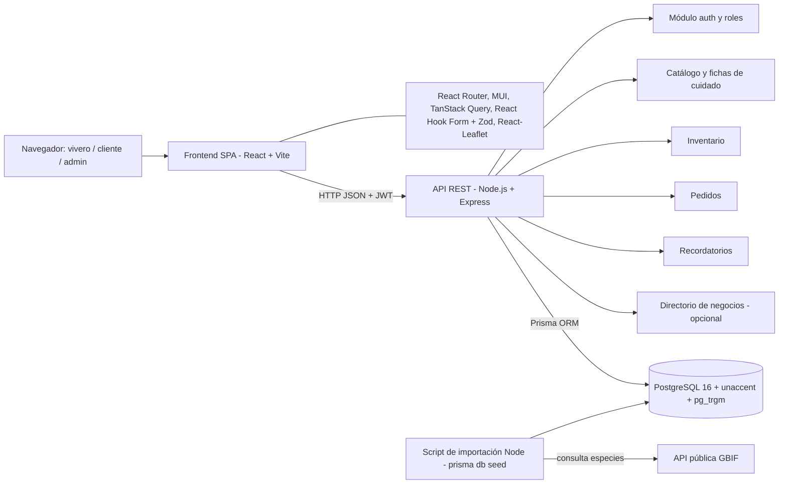
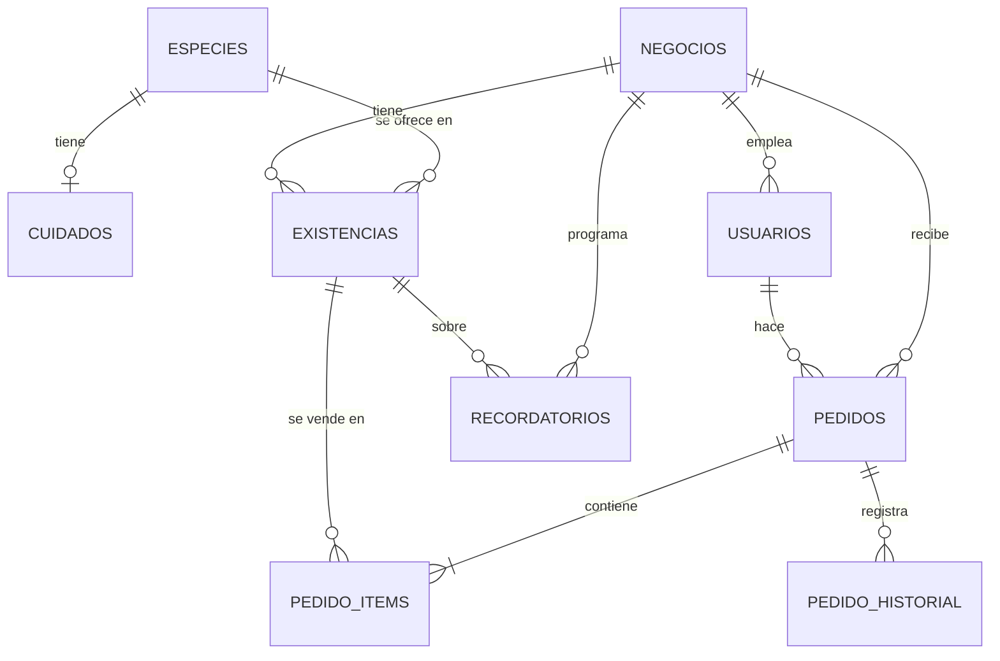

# Proyecto Corredor Ecológico: app para viveros (ficha central) — versión PostgreSQL + React

> Es la ficha de trabajo de **Julian Chavez** (Ingeniería de Software, UNIMINUTO, único integrante).
> **Versión 2 (27/10/2026):** cambia el stack a **PostgreSQL + frameworks y bibliotecas del ecosistema React**, por pedido de Julian. La versión anterior (MongoDB) se conserva en `Proyecto-Vivero-Corredor-Ecologico.md`. Ver **9.1 Cambio de tecnologías y su impacto**.
> Fuentes: `investigacion.md`, `Proyecto-de-Aula-Corredor-Ecologico-borrador.docx` (y `build/content.py`) y el contexto que dio Julian. Lo que viene de afuera tiene su URL y se revisó el 25/10/2026; los límites de hosting de PostgreSQL se revisaron el 27/10/2026.
> Etiquetas: **[CONFIRMADO]** = lo dice una fuente o Julian · **[PROPUESTO]** = idea de diseño, nadie la ha validado · **[POR CONFIRMAR]** = falta un dato.
> Ojo: este proyecto **no es** el Taller 1 (directorio de casas desarrolladoras con MongoDB).

---

## 1. Resumen y estado actual

**Resumen (5 líneas)**
1. *VerdeCorredor* (nombre propuesto) es una aplicación web con CRUD sobre **PostgreSQL** y frontend en **React**, pensada para los viveros y emprendimientos verdes del Corredor Ecológico Universitario de Villavicencio.
2. Ayudaría a manejar el catálogo de especies nativas, el inventario, los pedidos y las fichas de cuidado.
3. Los nombres científicos se traerían de la API pública de GBIF. La lista base de especies sale de Cormacarena y de la revista Nodo (UAN).
4. Hay módulos opcionales: directorio de negocios con guía de formalización (con mapa React-Leaflet), y "adopta un árbol".
5. Lo hace una sola persona en 16 semanas. El 28/10/2026 se entrega solo un **avance** (documento + maqueta de pantallas).

**Estado**

| Estado | Elemento |
|---|---|
| ✅ Hecho | Investigación documental (`investigacion.md`), borrador del Proyecto de Aula (.docx, todavía con MongoDB/Flask), modelo de datos preliminar (en anexos), guías de encuesta y entrevista en borrador |
| 🟡 En curso | Avance del 28/10 (el documento está en borrador; la maqueta de pantallas todavía no existe); cambio de stack a PostgreSQL + React (esta ficha) |
| ⬜ Falta | Trabajo de campo, requisitos validados, diseño final, código, pruebas, piloto, manual, informe; actualizar el Word al nuevo stack |
| ❓ Por confirmar | Código del proyecto, fechas, asignatura, semestre, línea de investigación, ODS, backend (Express o Next.js), negocios reales en el corredor, vivero piloto |

## 2. Datos académicos y entregas

| Campo | Valor | Estado |
|---|---|---|
| Programa | Ingeniería de Software | CONFIRMADO |
| Docente | Pedro Alejandro Alomía Florez | CONFIRMADO |
| NRC | 66987 | CONFIRMADO |
| Estudiante | Julian Esteban Chavez Zamora, ID 1055097, julian.chavez-z@uniminuto.edu.co | CONFIRMADO |
| Sede | UNIMINUTO Rectoría Orinoquía, Centro Universitario Villavicencio | CONFIRMADO (borrador) |
| Agenda territorial | Villavicencio Social e Innovadora | CONFIRMADO (borrador) |
| Línea institucional | Innovaciones sociales y productivas | PROPUESTO, falta confirmarla con el docente |
| Línea del programa | — | POR CONFIRMAR |
| Asignatura / Semestre | — | POR CONFIRMAR |
| Código del proyecto | — | POR COMPLETAR |
| Fecha de inicio / fin | — | POR COMPLETAR |
| Requisito técnico | **Ninguna tecnología es obligatoria**; las tecnologías son libres | CONFIRMADO (Julian, 27/10/2026) |
| Stack elegido | Base de datos **PostgreSQL**; front y back con frameworks/bibliotecas de React | CONFIRMADO (decisión de Julian, 27/10/2026); detalles de bibliotecas PROPUESTOS |

**Entregas**

| Fecha | Qué | Proyecto |
|---|---|---|
| Miércoles 28/10/2026 | Taller 1 completo (directorio de casas desarrolladoras) | Otro proyecto |
| Miércoles 28/10/2026 | **Avance del corredor**: documento en borrador (planteamiento, objetivos, metodología, cronograma, presupuesto) + **maqueta de pantallas** (inicio de sesión, catálogo de especies, ficha de especie y cuidado, inventario y pedidos) | Este proyecto |
| Semanas 15-16 (sin fecha) | Informe final y sustentación | Este proyecto |

## 3. El corredor: contexto y hallazgos

**Verificado (con fuente)**

| Hallazgo | Fuente |
|---|---|
| Es una vía de unos 4,3 km (4.387 m) entre el puente del río Ocoa y el cruce El Palmar (Comuna 7). Tiene dos carriles, andenes, ciclorruta, puentes y alumbrado, y es salida alterna a la Comuna 8 y a la vía a Puerto López | [Periódico del Meta](https://periodicodelmeta.com/inaugurado-corredor-ecologico-de-villavicencio/), [proyecto](https://periodicodelmeta.com/en-marcha-proyecto-para-la-construccion-de-corredor-ecologico-en-villavicencio/) |
| Lo pagó la Gobernación del Meta con regalías (OCAD, 2015) y lo ejecutó la Alcaldía (contrato 1424 de 2016). La obra se suspendió en 2017, se reanudó en 2018 y el terreno antes era un botadero | [Llano al Mundo](https://llanoalmundo.com/asi-avanza-la-obra-del-corredor-ecologico-de-villavicencio/) |
| Inversión de unos $29.000 millones | [Periódico del Meta](https://periodicodelmeta.com/inaugurado-corredor-ecologico-de-villavicencio/) |
| En la obra se aprovecharon 1.200 árboles, se compensó con 10.447 y se sembraron 200 nativos | Llano al Mundo (2018), según el borrador |
| Entre 2017 y 2021 se perdió un 7 % de cobertura boscosa en el sector San Carlos | [Dynamikos](https://doi.org/10.64351/10.64351/rdynamikos.vol5.n1.art1) |
| UNIMINUTO tiene un proyecto de clúster inclusivo en el tramo 1 (vereda Barcelona) | [UNIMINUTO](https://www.uniminuto.edu/noticias/proyecto-corredor-ecologico) |
| Ya existe un antecedente de software: BioScan (divulgación ambiental, trabajo de grado) | [Repositorio UNIMINUTO](https://repository.uniminuto.edu/items/0267b5cf-bf90-49d8-9a5e-cd30c5d51f21) |
| 2026: sembraron 130 plantas en el "corredor ecológico Amarillo" (vereda Barcelona) y están reparando el alumbrado | [Qué pasó en Villavo](https://quepasoenvillavo.com.co/2026/09/22/nuevas-especies-llenan-de-vida-el-corredor-ecologico-amarillo-de-villavicencio/), [Noticias Ya](https://www.joseivanaguilar.com/alborada-recupera-iluminacion-del-corredor-ecologico/) |
| Cormacarena opera el mega vivero La Bella: unas 30 especies nativas y más de 300.000 plántulas al año | [Villavo Noticias](https://www.villavonoticias.com/cormacarena-inauguro-mega-vivero-en-villavicencio-que-producira-300-000-plantulas-al-ano/) |
| Ejemplos de viveros en la ciudad: El Arrendajo (Anillo Vial, hace domicilios), Garden Loren's, Sembrarte, Cataleya, CorpOrquídea, Las Camilas, Verde Grillo, El Sol | [Shops1000](https://www.shops1000.com/CO/Villavicencio/106678798649549/Vivero-el-Arrendajo), [Polomap](https://co.polomap.com/villavicencio/plant-nursery) |
| El RUVI tiene más de 1.300 vendedores informales caracterizados (**dato de la ciudad, no del corredor**) | [Periódico del Meta](https://periodicodelmeta.com/la-lucha-por-el-espacio-publico-en-navidad/) |

**Lo que NO se pudo confirmar**
- Que exista de verdad el "Vivero El Paraíso de las Plantas, Corredor Ecológico Km 2". Solo aparece en un directorio sin verificar (Polomap).
- Ningún otro negocio con nombre dentro del corredor (ni floristerías ni artesanos).
- Quién administra hoy el corredor, y si hay un documento oficial con sus objetivos ambientales.
- Qué papel tiene Cormacarena en el corredor.
- Que algún vivero quiera ser usuario piloto.


## 4. Problema, justificación, pregunta y objetivos

**Problema (hipótesis que hay que validar en campo).** Los pequeños viveros llevan sus registros a mano o de forma dispersa (cuaderno, chat, Excel), no existe un inventario abierto de especies de Villavicencio y la informalidad les cierra el paso a herramientas. Lo que puede pasar: ventas perdidas, plantas que se mueren por falta de seguimiento y una oferta nativa que casi nadie ve.

**Justificación (resumen).** El corredor es una obra pública grande y tiene comunidades alrededor. El proyecto aplica requisitos, **modelado relacional (SQL)**, desarrollo web con React y pruebas a un problema real. Puede conectarse con el clúster de UNIMINUTO, usa herramientas gratuitas y, a diferencia de BioScan, se enfoca en la gestión de los negocios y no en la divulgación. *(Cambio frente al borrador: decía "modelado NoSQL" y "desarrollo web en Python".)*

**Pregunta de investigación [PROPUESTA de redacción, cambia "MongoDB" por "PostgreSQL"].** ¿Cómo puede una aplicación web con interfaz gráfica y operaciones CRUD sobre PostgreSQL apoyar a los viveros y emprendimientos verdes del Corredor Ecológico Universitario de Villavicencio en la gestión de su catálogo de especies nativas, inventario, pedidos y fichas de cuidado?

**Objetivo general [PROPUESTO].** Desarrollar una aplicación web con interfaz gráfica en React y operaciones CRUD sobre PostgreSQL que permita a los viveros y emprendimientos verdes del corredor gestionar su catálogo de especies nativas, inventario, pedidos y fichas de cuidado.

**Objetivos específicos**
1. Caracterizar con trabajo de campo los viveros y emprendimientos del corredor, y ver cómo registran hoy su catálogo, inventario y pedidos.
2. Definir los requisitos y diseñar el **modelo relacional en PostgreSQL** y las pantallas.
3. Implementar la app (**React en el frontend, Node.js en el backend**) con CRUD de especies, inventario, pedidos y fichas de cuidado, e importar nombres científicos desde GBIF. *(El borrador dice "en Python"; con el nuevo stack se cambia a JavaScript/TypeScript.)*
4. Evaluarla con pruebas funcionales y de usabilidad (y con un piloto, si un vivero acepta), y documentar los resultados y el manual.

## 5. Propuesta de producto [PROPUESTO]

**Usuarios**

| Rol | Quién | Qué hace |
|---|---|---|
| `admin` | Julian / el docente | Gestiona usuarios y el catálogo base de especies |
| `vivero` | Dueño o empleado de un vivero | Inventario, pedidos, cuidados, perfil del negocio |
| `cliente` | Comunidad / comprador | Ve el catálogo, hace pedidos, recibe la ficha de cuidado |
| (público) | Cualquier persona | Ve el catálogo de especies y el directorio |

**Historias de usuario (borrador)**
- HU1. Como vivero, quiero buscar una especie por nombre común o científico, **aunque no escriba tildes ni mayúsculas**, para encontrarla rápido.
- HU2. Como vivero, quiero registrar existencias (presentación, tamaño, precio, cantidad) para saber qué tengo disponible.
- HU3. Como vivero, quiero ver alertas de stock bajo para reponer a tiempo.
- HU4. Como cliente, quiero hacer un pedido y seguir su estado (pendiente, confirmado, entregado, cancelado).
- HU5. Como cliente, quiero ver la ficha de cuidado de la planta que compré (luz, riego, suelo, trasplante, plagas).
- HU6. Como vivero, quiero programar recordatorios de riego, siembra y poda.
- HU7. Como admin, quiero importar el nombre científico y la familia desde GBIF para no escribirlos a mano.
- HU8 (opcional). Como emprendedor, quiero registrar mi negocio y seguir una guía para formalizarme (Cámara de Comercio, RUT).
- HU9 (opcional). Como ciudadano, quiero "adoptar" un árbol sembrado y reportar si está deteriorado o hay basura.

**Funcionalidades: MVP y opcionales**

| Funcionalidad | Prioridad | Sprint (borrador) |
|---|---|---|
| Inicio de sesión y roles | MVP | 1 |
| Catálogo de especies nativas + fichas de cuidado | MVP | 1 (catálogo + GBIF) / 3 (fichas) |
| Importar desde GBIF | MVP | 1 |
| Inventario (existencias) | MVP | 2 |
| Pedidos | MVP | 2 |
| Reportes simples (stock, pedidos por estado) | MVP | 3 |
| Recordatorios de riego, siembra y poda | Opcional (o MVP básico: lista de próximas tareas dentro de la app, sin notificaciones) | 3 |
| Directorio de negocios + guía de formalización | Opcional (el borrador lo deja como secundario) | 13-14 |
| Mapa de negocios (React-Leaflet + OSM) | Opcional | — |
| "Adopta un árbol" / reporte ciudadano | Opcional, fuera del alcance inicial | — |

**Alcance para una sola persona:** primero el MVP (catálogo, inventario, pedidos, fichas). Lo opcional se hace solo si sobra tiempo. Hay que validar la maqueta con un vivero antes de programar (recomendación del borrador).

## 6. Arquitectura propuesta [PROPUESTO]



**Módulos:** auth, especies y cuidados, inventario, pedidos, recordatorios, negocios (opcional) e importación (script aparte, en Node, reutiliza el cliente Prisma).

**Flujo de datos**
1. El script de importación (Node) consulta GBIF (`/v1/species/match` o `/v1/species/search`), normaliza los datos y hace *upsert* en `especies` usando `gbif_key` (único) como clave (`INSERT ... ON CONFLICT (gbif_key) DO UPDATE`).
2. El vivero inicia sesión, la API le devuelve un JWT y el front (TanStack Query) lo manda en `Authorization`.
3. Crear un pedido revisa el stock y lo descuenta **dentro de una transacción SQL** (`BEGIN ... COMMIT`, con `prisma.$transaction`). Cada ítem hace `UPDATE existencias SET cantidad = cantidad - n WHERE id = $1 AND cantidad >= n`; si alguna fila no se actualiza, se hace `ROLLBACK`. Además hay un `CHECK (cantidad >= 0)` como red de seguridad.
4. Recordatorios: una tarea programada (`node-cron` dentro de la API) marca los que ya vencieron. Al principio solo se muestran en la app.

**Autenticación y roles:** contraseñas con hash (bcrypt), un JWT con `rol` y `negocio_id`, y un middleware de Express que revisa el rol. Cada vivero solo ve y edita sus propios datos (filtro `WHERE negocio_id = :del_token` en cada consulta; opcional: Row Level Security de PostgreSQL). Consentimiento según la Ley 1581 de 2012 (hay que revisar la cita, ver la sección 13).

**Despliegue** (límites verificados el 27/10/2026 en las páginas oficiales)

| Opción | Uso | Límites del plan gratis |
|---|---|---|
| Local con Docker Compose (imagen `postgres:16`) | Desarrollo y demo en clase | Ninguno; depende del portátil |
| **Neon Free** (recomendado para la BD en la nube) | BD para la demo o el piloto | 1 GB por proyecto (20 GB en total), 100 CU-horas/proyecto/mes, se suspende tras 5 min sin uso (arranca solo al conectarse), 5 GB de transferencia/proyecto/mes. Si se pasa del límite no borra datos. [Planes](https://neon.com/docs/introduction/plans), [FAQ límites](https://neon.com/faqs/free-plan-limits-and-quotas) |
| Supabase Free | Alternativa (PostgreSQL + almacenamiento de archivos) | 500 MB de BD por proyecto, 2 proyectos activos, 1 GB de archivos, 5 GB de egreso; **se pausa tras 1 semana de inactividad** (se puede reanudar). Sin backups automáticos. [Precios](https://supabase.com/pricing), [pausa](https://supabase.com/docs/guides/platform/free-project-pausing) |
| Render Postgres Free | No recomendado para el piloto | 1 GB, una sola BD gratis por workspace, **expira a los 30 días** (14 días de gracia y luego se borra), sin backups. [Render Free](https://render.com/docs/free) |
| Render, web service Free | Hosting de la API Express (y sitio estático para el front de Vite) | Se apaga tras 15 min sin tráfico (tarda ~1 min en volver), 750 h al mes por workspace, disco efímero. [Render Free](https://render.com/docs/free) |

Recomendación [PROPUESTO]: desarrollar en local con Compose; para el piloto, **Neon Free (BD) + Render Free (API y front estático)**. Las imágenes **no** se guardan en el disco de Render (ver sección 9).

## 7. Modelo de datos relacional en PostgreSQL [PROPUESTO, adaptado del anexo del borrador]

**Tablas**

| Tabla | Contenido | Clave primaria | Claves foráneas / relación |
|---|---|---|---|
| `especies` | nombre común, nombre científico, familia, `gbif_key` (único), nativa, usos, fuentes | `id` | — |
| `cuidados` | ficha por especie: luz, riego, suelo, trasplante, plagas | `especie_id` | `especie_id → especies` (1:1) |
| `negocios` | directorio, tipo, sector, ubicación, formalización, verificado | `id` | — |
| `usuarios` | clientes, viveros y admin con su rol y consentimiento | `id` | `negocio_id → negocios` (N:1, opcional) |
| `existencias` | inventario: presentación, tamaño, precio, cantidad, stock mínimo, ubicación | `id` | `negocio_id → negocios`, `especie_id → especies` (N:1 cada una) |
| `pedidos` | cliente, negocio, fecha, estado, total | `id` | `negocio_id → negocios`, `cliente_id → usuarios` |
| `pedido_items` | líneas del pedido (antes subdocumento `items`) | `id` | `pedido_id → pedidos` (ON DELETE CASCADE), `existencia_id → existencias` |
| `pedido_historial` | cambios de estado (antes arreglo `historial`) | `id` | `pedido_id → pedidos` |
| `recordatorios` | tarea (riego, siembra, poda), próxima fecha, cada cuántos días, hecho | `id` | `negocio_id → negocios`, `existencia_id → existencias` (opcional), `especie_id → especies` (opcional) |

**Relaciones (resumen):** un negocio tiene muchas existencias, pedidos, usuarios y recordatorios; una especie tiene una ficha de cuidado y aparece en muchas existencias; un pedido tiene muchos ítems y muchos cambios de estado.



**DDL SQL de ejemplo** (ilustrativo; con Prisma se generaría desde `schema.prisma` y migraciones, pero las extensiones e índices especiales se agregan en una migración SQL manual)

```sql
CREATE EXTENSION IF NOT EXISTS unaccent;
CREATE EXTENSION IF NOT EXISTS pg_trgm;

CREATE TYPE rol_usuario    AS ENUM ('admin', 'vivero', 'cliente');
CREATE TYPE estado_pedido  AS ENUM ('pendiente', 'confirmado', 'entregado', 'cancelado');
CREATE TYPE tipo_tarea     AS ENUM ('riego', 'siembra', 'poda');

-- unaccent() no es IMMUTABLE; este envoltorio permite usarlo en índices
CREATE OR REPLACE FUNCTION f_unaccent(text) RETURNS text
  LANGUAGE sql IMMUTABLE PARALLEL SAFE STRICT
  AS $$ SELECT public.unaccent('public.unaccent'::regdictionary, $1) $$;

CREATE TABLE especies (
  id                BIGINT GENERATED ALWAYS AS IDENTITY PRIMARY KEY,
  nombre_comun      TEXT NOT NULL,
  nombre_cientifico TEXT,
  familia           TEXT,
  gbif_key          BIGINT UNIQUE,              -- NULL permitido hasta importar de GBIF
  nativa            BOOLEAN NOT NULL DEFAULT true,
  usos              TEXT[] NOT NULL DEFAULT '{}',
  fuentes           TEXT[] NOT NULL DEFAULT '{}',
  creado_en         TIMESTAMPTZ NOT NULL DEFAULT now()
);

CREATE TABLE cuidados (
  especie_id  BIGINT PRIMARY KEY REFERENCES especies(id) ON DELETE CASCADE,
  luz         TEXT, riego TEXT, suelo TEXT, trasplante TEXT,
  plagas      TEXT[] NOT NULL DEFAULT '{}',
  fuente      TEXT                               -- obligatorio citar de dónde sale la ficha
);

CREATE TABLE negocios (
  id             BIGINT GENERATED ALWAYS AS IDENTITY PRIMARY KEY,
  nombre         TEXT NOT NULL,
  tipo           TEXT NOT NULL DEFAULT 'vivero',
  sector         TEXT,
  lat            NUMERIC(9,6), lng NUMERIC(9,6),  -- PostGIS solo si hiciera falta
  telefono       TEXT,
  formalizacion  JSONB NOT NULL DEFAULT '{}',     -- p. ej. {"camara_comercio":"en_proceso","rut":"no"}
  verificado     BOOLEAN NOT NULL DEFAULT false
);

CREATE TABLE usuarios (
  id                  BIGINT GENERATED ALWAYS AS IDENTITY PRIMARY KEY,
  nombre              TEXT NOT NULL,
  email               TEXT NOT NULL,
  password_hash       TEXT NOT NULL,
  rol                 rol_usuario NOT NULL,
  negocio_id          BIGINT REFERENCES negocios(id) ON DELETE SET NULL,
  consentimiento_at   TIMESTAMPTZ NOT NULL,       -- Ley 1581 de 2012
  CHECK (rol <> 'vivero' OR negocio_id IS NOT NULL)
);
CREATE UNIQUE INDEX usuarios_email_uq ON usuarios (lower(email));

CREATE TABLE existencias (
  id             BIGINT GENERATED ALWAYS AS IDENTITY PRIMARY KEY,
  negocio_id     BIGINT NOT NULL REFERENCES negocios(id) ON DELETE CASCADE,
  especie_id     BIGINT NOT NULL REFERENCES especies(id),
  presentacion   TEXT NOT NULL,
  tamano_cm      INTEGER,
  precio_cop     INTEGER NOT NULL CHECK (precio_cop >= 0),
  cantidad       INTEGER NOT NULL CHECK (cantidad >= 0),
  stock_minimo   INTEGER NOT NULL DEFAULT 0,
  ubicacion      TEXT,
  actualizado_en TIMESTAMPTZ NOT NULL DEFAULT now(),
  UNIQUE (negocio_id, especie_id, presentacion, tamano_cm)
);

CREATE TABLE pedidos (
  id          BIGINT GENERATED ALWAYS AS IDENTITY PRIMARY KEY,
  negocio_id  BIGINT NOT NULL REFERENCES negocios(id),
  cliente_id  BIGINT NOT NULL REFERENCES usuarios(id),
  estado      estado_pedido NOT NULL DEFAULT 'pendiente',
  total_cop   INTEGER NOT NULL DEFAULT 0,
  creado_en   TIMESTAMPTZ NOT NULL DEFAULT now()
);

CREATE TABLE pedido_items (
  id              BIGINT GENERATED ALWAYS AS IDENTITY PRIMARY KEY,
  pedido_id       BIGINT NOT NULL REFERENCES pedidos(id) ON DELETE CASCADE,
  existencia_id   BIGINT NOT NULL REFERENCES existencias(id),
  descripcion     TEXT NOT NULL,                  -- copia del nombre al momento de la venta
  cantidad        INTEGER NOT NULL CHECK (cantidad > 0),
  precio_unit_cop INTEGER NOT NULL CHECK (precio_unit_cop >= 0)
);

CREATE TABLE pedido_historial (
  id         BIGINT GENERATED ALWAYS AS IDENTITY PRIMARY KEY,
  pedido_id  BIGINT NOT NULL REFERENCES pedidos(id) ON DELETE CASCADE,
  estado     estado_pedido NOT NULL,
  fecha      TIMESTAMPTZ NOT NULL DEFAULT now()
);

CREATE TABLE recordatorios (
  id             BIGINT GENERATED ALWAYS AS IDENTITY PRIMARY KEY,
  negocio_id     BIGINT NOT NULL REFERENCES negocios(id) ON DELETE CASCADE,
  existencia_id  BIGINT REFERENCES existencias(id) ON DELETE CASCADE,
  especie_id     BIGINT REFERENCES especies(id),
  tipo           tipo_tarea NOT NULL,
  proxima_fecha  TIMESTAMPTZ NOT NULL,
  cada_dias      INTEGER CHECK (cada_dias > 0),
  hecho          BOOLEAN NOT NULL DEFAULT false
);

-- Índices
CREATE INDEX especies_busqueda_trgm ON especies
  USING gin (f_unaccent(lower(nombre_comun || ' ' || coalesce(nombre_cientifico, ''))) gin_trgm_ops);
CREATE INDEX existencias_negocio_idx   ON existencias (negocio_id);
CREATE INDEX existencias_especie_idx   ON existencias (especie_id);
CREATE INDEX pedidos_negocio_estado    ON pedidos (negocio_id, estado, creado_en DESC);
CREATE INDEX pedidos_cliente_idx       ON pedidos (cliente_id);
CREATE INDEX pedido_items_pedido_idx   ON pedido_items (pedido_id);
CREATE INDEX recordatorios_pendientes  ON recordatorios (negocio_id, proxima_fecha) WHERE NOT hecho;
```

**Búsqueda sin tildes ni mayúsculas (HU1)**

```sql
-- "guacimo", "GUÁCIMO" o "guaci" encuentran "Guácimo"; "cana" encuentra "Caña" (unaccent convierte ñ→n)
SELECT id, nombre_comun, nombre_cientifico
FROM especies
WHERE f_unaccent(lower(nombre_comun || ' ' || coalesce(nombre_cientifico, '')))
      LIKE '%' || f_unaccent(lower($1)) || '%'
ORDER BY similarity(f_unaccent(lower(nombre_comun)), f_unaccent(lower($1))) DESC
LIMIT 20;
```
> A diferencia de la collation `es` de MongoDB (sección 7 de la versión anterior), `unaccent` sí trata la ñ como n. El índice GIN de `pg_trgm` acelera `LIKE '%...%'` y permite tolerar errores de escritura con `similarity()` / `%`. Alternativa: una collation ICU no determinista (`CREATE COLLATION ... provider = icu, deterministic = false`), pero no sirve para `LIKE`; por eso se propone `unaccent + pg_trgm`. Neon y Supabase permiten instalar ambas extensiones **[POR CONFIRMAR al crear el proyecto]**.

**Datos de ejemplo (ilustrativos; los de cuidado hay que llenarlos desde una fuente confiable y las coordenadas no son reales)**

```sql
INSERT INTO especies (nombre_comun, nombre_cientifico, familia, gbif_key, nativa, usos, fuentes)
VALUES ('Ocobo', 'Tabebuia rosea', 'Bignoniaceae', NULL, true,
        ARRAY['ornamental','sombra'], ARRAY['Cormacarena','Revista Nodo UAN']);
INSERT INTO cuidados (especie_id, luz, riego, suelo, trasplante)
VALUES (1, 'por definir', 'por definir', 'por definir', 'por definir');
INSERT INTO negocios (nombre, tipo, sector, lat, lng)
VALUES ('…', 'vivero', 'Corredor Ecológico, tramo 1', 4.1, -73.6);  -- coordenadas no reales
INSERT INTO existencias (negocio_id, especie_id, presentacion, tamano_cm, precio_cop, cantidad, stock_minimo, ubicacion)
VALUES (1, 1, 'bolsa', 40, 0, 25, 5, 'era 3');
```

## 8. API REST [PROPUESTO]

Las rutas no cambian frente a la versión MongoDB; los `:id` pasan de ObjectId a enteros (`BIGINT`). Validación de entrada con **Zod** (el mismo esquema se reutiliza en React Hook Form).

| Método | Ruta | Rol | Descripción |
|---|---|---|---|
| POST | `/api/auth/registro` | público | Crear cuenta (con consentimiento) |
| POST | `/api/auth/login` | público | Devuelve el JWT |
| GET | `/api/auth/yo` | autenticado | Perfil |
| GET | `/api/especies?q=&nativa=&page=` | público | Listar o buscar (sin tildes, `unaccent` + `pg_trgm`) |
| GET | `/api/especies/:id` | público | Detalle + ficha de cuidado (JOIN con `cuidados`) |
| POST/PUT/DELETE | `/api/especies[/:id]` | admin | CRUD |
| POST | `/api/especies/importar-gbif` | admin | Importar por nombre científico (también puede hacerse con el script) |
| GET/POST | `/api/existencias` | vivero | Inventario del propio negocio |
| PUT/DELETE | `/api/existencias/:id` | vivero | Editar o borrar |
| GET | `/api/existencias/stock-bajo` | vivero | Alertas (`cantidad <= stock_minimo`) |
| GET | `/api/catalogo/:negocioId` | público | Lo que tiene disponible un vivero |
| POST | `/api/pedidos` | cliente | Crear pedido (transacción que descuenta stock) |
| GET | `/api/pedidos` | cliente/vivero | Mis pedidos / los pedidos del negocio |
| PATCH | `/api/pedidos/:id/estado` | vivero | Cambiar el estado (inserta en `pedido_historial`) |
| GET/POST/PUT/DELETE | `/api/recordatorios[/:id]` | vivero | CRUD de recordatorios |
| GET | `/api/recordatorios/proximos` | vivero | Lo que vence en los próximos días |
| GET | `/api/reportes/resumen` | vivero | Stock y pedidos por estado (`GROUP BY`) |
| GET/POST/PUT | `/api/negocios[/:id]` | público/vivero | Directorio (opcional) |
| GET | `/api/negocios/:id/formalizacion` | vivero | Pasos de la guía (opcional) |

## 9. Tecnologías posibles

✅T1 = ya se usa en el Taller 1 (Node + Express para la API, front con Vite en `localhost:5173`, Docker Compose). Lo que era de Mongo/Python (pymongo, Mongo 7.0) ya no aplica.

| Área | Opciones | Recomendación y por qué [PROPUESTO] |
|---|---|---|
| Base de datos | **PostgreSQL 16** (Docker en local; Neon/Supabase en la nube) | Elegida por Julian (tecnologías libres). Relacional con transacciones ACID, claves foráneas y `CHECK`, ideal para inventario y pedidos. Ver 9.1 |
| Backend | **Node.js + Express ✅T1** con Prisma o `pg` (node-postgres); Next.js (full-stack) | **Express**: ya lo conoce del Taller 1, API REST separada fácil de probar con Postman. Next.js uniría front y back en un proyecto, pero agrega SSR, Server Components y otro modelo mental; además no encaja con "front SPA con Vite" |
| Acceso a datos (ORM) | **Prisma**, `pg` con SQL a mano, Drizzle | **Prisma**: esquema declarativo, migraciones, tipos y `$transaction`; para `unaccent`/`pg_trgm` se usa `$queryRaw` y una migración SQL. `pg` es más ligero y enseña más SQL, pero hay que escribir migraciones a mano. Drizzle es buena opción, pero menos documentada en español |
| Frontend | **React + Vite ✅T1** | SPA servida como sitio estático (gratis en Render). Create React App ya está obsoleto |
| Enrutamiento | **React Router** | Rutas públicas/privadas por rol (`/catalogo`, `/inventario`, `/pedidos`) |
| UI | **MUI (Material UI)**, Chakra UI, Mantine, shadcn/ui + Tailwind | **MUI**: tablas (DataGrid gratis en su versión community), formularios y diálogos listos, buena documentación; útil para la maqueta. shadcn/ui es más flexible, pero exige Tailwind |
| Datos del servidor | **TanStack Query** | Caché, estados de carga/error, invalidación tras crear/editar (inventario y pedidos) |
| Formularios | **React Hook Form + Zod** | Validación compartida con el backend |
| Mapas | **React-Leaflet** + OpenStreetMap | Solo si se hace el directorio. Gratis, pero hay que respetar la política de uso de los tiles de OSM |
| Importación | Script en **Node** (`fetch` nativo) + Prisma, GBIF API | Reemplaza el script Python + pymongo. GBIF da JSON estructurado y la mayoría de consultas no piden autenticación ([GBIF API](https://techdocs.gbif.org/en/openapi/)) |
| Recordatorios | `node-cron` dentro de la API; email/WhatsApp después | MVP: lista en la app + cron (costos y límites de email/WhatsApp no verificados) |
| Imágenes | Carpeta local en desarrollo, URLs, Supabase Storage (1 GB gratis) | No usar el disco de Render (efímero, [Render](https://render.com/docs/free)). No guardar imágenes en la BD |
| Pruebas | **Vitest** + React Testing Library (front), Jest/Vitest + Supertest (API), Postman | Vitest se integra con Vite |
| Contenedores | **Docker Compose ✅T1** | `postgres:16` + API (+ front) en un `compose.yaml` |
| Control de versiones | Git + GitHub | Ya está en el borrador |

**PostgreSQL vs MongoDB para este proyecto**

| Criterio | PostgreSQL | MongoDB (versión anterior) |
|---|---|---|
| Modelo | Tablas, filas, claves foráneas; JSONB para lo flexible | Documentos JSON, subdocumentos |
| Integridad | FK, `CHECK`, `UNIQUE`, `NOT NULL` en la BD | Se valida en la app (o con JSON Schema) |
| Pedidos y stock | Transacciones ACID multi-tabla nativas | Atómico por documento; transacciones multi-documento posibles, pero más complejas |
| Búsqueda sin tildes | `unaccent` + `pg_trgm` (ñ→n incluido, búsqueda parcial) | Collation `es` strength 1 (ñ ≠ n), regex o índice de texto |
| Reportes | SQL con `JOIN` y `GROUP BY` | Aggregation pipeline |
| Hosting gratis | Neon 1 GB, Supabase 500 MB, Render 1 GB por 30 días | Atlas Free 512 MB |
| Requisito del curso | Tecnologías libres: válida | Tecnologías libres: válida |
| Reutilizar Taller 1 | Solo Express, Vite y Compose | Conexión, Compose y búsqueda |

### 9.1 Cambio de tecnologías y su impacto

**Qué cambia:** MongoDB → **PostgreSQL**; Flask/Python/PyMongo → **React (Vite, React Router, MUI, TanStack Query, React Hook Form, React-Leaflet) + Node/Express + Prisma**; script de importación Python → Node. Decisión libre de Julian del 27/10/2026: en este proyecto ninguna tecnología es obligatoria. Esta subsección es solo informativa.

> ℹ️ El borrador del Word se redactó con MongoDB, Flask y Python. Como las tecnologías son libres, no hace falta ningún permiso; solo hay que actualizar el texto del Word para que sea coherente con el nuevo stack (tabla de abajo).

**Impacto en el trabajo:** se pierde la reutilización de la conexión y la búsqueda sin tildes del Taller 1; hay que aprender SQL/Prisma y migraciones (+1 semana estimada en el sprint 1, ver cronograma). A cambio, pedidos/stock y reportes se vuelven más simples y seguros.

**Partes del Word (`build/content.py` → .docx) que habría que actualizar para que mencionen PostgreSQL/React en vez de Mongo/Flask/Python**

| Parte del Word | Dice hoy | Cambiar a |
|---|---|---|
| Resumen / descripción (content.py l. 28) | "CRUD sobre MongoDB, desarrollada en Python con un framework web" | "CRUD sobre PostgreSQL, con React y Node.js" |
| Pregunta de investigación (l. 48) | "sobre MongoDB" | "sobre PostgreSQL" |
| Justificación: pertinencia académica (l. 52) | "modelado de datos NoSQL, desarrollo web en Python" | "modelado relacional (SQL), desarrollo web con React y Node.js" |
| Justificación: pertinencia tecnológica (l. 54) | "Python, un framework web como Flask y MongoDB… MongoDB permite guardar fichas…" | "PostgreSQL, React, Node.js/Express"; quitar el argumento de documentos flexibles (o mencionar JSONB) |
| Objetivo general (l. 58) | "sobre MongoDB" | "sobre PostgreSQL" |
| Objetivo específico 2 (l. 61) | "modelo de datos en MongoDB" | "modelo relacional en PostgreSQL" |
| Objetivo específico 3 (l. 62) | "aplicación web en Python" | "aplicación web con React (frontend) y Node.js (backend)" |
| Marco conceptual: conceptos tecnológicos (l. 70) | CRUD "en MongoDB, una base de datos orientada a documentos" | CRUD en SQL (`INSERT/SELECT/UPDATE/DELETE`), base de datos relacional |
| Fases del proyecto (l. 81) y cronograma (l. 92) | "modelo de datos en MongoDB" / "Modelo de datos MongoDB y arquitectura" | "Modelo relacional PostgreSQL y arquitectura" |
| Recursos tecnológicos (l. 107) | "Python, Flask (propuesto) y PyMongo; MongoDB Community o Atlas" | "Node.js, React + Vite, Prisma; PostgreSQL (Docker) o Neon Free" |
| Presupuesto: software (l. 116) | "Python, Flask, MongoDB Community o Atlas gratuito…" | "Node.js, React, PostgreSQL, Neon/Render gratuitos…" ($0, no cambia) |
| Productos esperados (l. 126-127) | "modelo de datos en MongoDB", "aplicación web en Python" | "modelo relacional en PostgreSQL", "aplicación web en React + Node.js" |
| Referencias (l. 158, 162) | MongoDB CRUD, Flask | PostgreSQL docs (y `unaccent`, `pg_trgm`), React, Prisma, Express |
| Anexo modelo de datos (l. 197) | "colecciones de MongoDB" | Tablas de la sección 7 de esta ficha |

## 10. Fuentes de datos

| Fuente | Qué aporta | Limitación |
|---|---|---|
| Lista de Cormacarena: ocobo, algarrobo, balso, guácimo, yopo, flor amarillo, caracolí, matarratón, cedro rosado, gualanday, cañafístula ([Villavo Noticias](https://www.villavonoticias.com/cormacarena-inauguro-mega-vivero-en-villavicencio-que-producira-300-000-plantulas-al-ano/), [Llano al Mundo](https://llanoalmundo.com/cormacarena-ha-sembrado-cerca-de-500-000-arboles-nativos-en-lo-corrido-del-2024/)) | Nombres comunes de la semilla inicial | No trae nombres científicos; hay que cruzarla con GBIF |
| Revista Nodo UAN, "Árboles para Villavicencio": *Ceiba pentandra*, *Hymenaea courbaril*, *Tabebuia rosea*, *Brownea ariza*, *Cecropia peltata*, *Anacardium excelsum*, *Crescentia cujete* ([PDF](https://revistas.uan.edu.co/index.php/nodo/en/article/download/372/312/608)) | Nombres científicos y árboles que alimentan a la fauna | Es de 2007 |
| Siembra de 2026 en el corredor: caballero de la noche, mirto, palma carey, palo cruz, francesina, coralitos ([Qué pasó en Villavo](https://quepasoenvillavo.com.co/2026/09/22/nuevas-especies-llenan-de-vida-el-corredor-ecologico-amarillo-de-villavicencio/)) | Especies que se usan hoy en el corredor | No todas tienen que ser nativas; hay que verificarlo |
| GBIF API / SiB Colombia ([ejemplo](https://api.gbif.org/v1/species/search?q=Tabebuia%20rosea), [docs](https://techdocs.gbif.org/en/openapi/)) | Taxonomía y `gbif_key` | Hay que respetar las licencias de cada dataset. La relación GBIF ↔ SiB Colombia está "sin verificar" en la investigación |
| Censo de árboles del JBB ([geoportal](https://geoportal.jbb.gov.co/agc/rest/services/IDECA/CensoArbol/MapServer/0/query)) | Modelo de esquema | Solo cubre Bogotá |

**Limitaciones:** en datos.gov.co **no hay** un inventario de árboles de Villavicencio. El inventario municipal de 2017 (10.043 árboles) no está publicado como dataset ([Decibeles](https://www.decibeles.com.co/inicio-inventario-de-arboles/)). No se consultaron el Instituto Humboldt ni el JBB para listas de especies. Las fichas de cuidado no tienen todavía una fuente.


## 11. Metodología, cronograma, recursos y presupuesto

**Metodología (del borrador):** enfoque mixto (Hernández-Sampieri & Mendoza, 2018), investigación aplicada y descriptiva, diseño no experimental + desarrollo iterativo (sprints de 2 semanas, Scrum adaptado a una persona). Muestra por conveniencia y bola de nieve: entre 3 y 5 negocios y al menos 1 vivero piloto, buscados a través del clúster de UNIMINUTO. Si no aparecen, se amplía a viveros de Villavicencio. Técnicas: revisión documental, entrevista semiestructurada, observación, encuestas y casos de prueba.

**Cronograma (16 semanas; la semana 1 empieza en la fecha de inicio [POR COMPLETAR]; ubicar el avance del 28/10 en la semana 2 es un supuesto). Cambios por el nuevo stack en negrita [PROPUESTO].**

| # | Actividad | Semanas |
|---|---|---|
| 1 | Revisión documental y delimitación | 1-2 |
| 2 | **Avance: documento + maqueta (28/10/2026)** | 2 |
| 3 | Diseño de instrumentos | 2-3 |
| 4 | Contacto con el clúster UNIMINUTO e identificación de negocios | 3-5 |
| 5 | Entrevistas y observación | 4-6 |
| 6 | Requisitos e historias de usuario | 6-7 |
| 6b | **Aprendizaje de SQL/Prisma y React Router/MUI/TanStack Query (en paralelo)** | **5-8** |
| 7 | **Modelo relacional PostgreSQL (DDL, migraciones) y arquitectura** | 7-8 |
| 8 | Prototipo de interfaz (componentes MUI) y validación | 8-9 |
| 9 | Sprint 1: catálogo + GBIF + búsqueda `unaccent`/`pg_trgm` | 9-10 |
| 10 | Sprint 2: inventario y pedidos (transacciones) | 11-12 |
| 11 | Sprint 3: fichas de cuidado y reportes | 12-13 |
| 12 | Directorio + React-Leaflet (opcional) | 13-14 |
| 13 | Pruebas funcionales (Vitest/Supertest/Postman) y de usabilidad | 11-14 |
| 14 | Piloto con un vivero (por confirmar), despliegue Neon + Render | 14-15 |
| 15 | Manual y documentación | 14-15 |
| 16 | Informe final y sustentación | 15-16 |

**Recursos:** Julian (todas las fases), el docente como asesor, viveros participantes (por confirmar). Portátil, internet, VS Code, Git/GitHub, **Node.js, React + Vite, PostgreSQL (Docker) / Neon Free, Prisma**, herramienta de maquetación (Figma o papel), GBIF API, celular. Formatos impresos y transporte. Salas de informática de UNIMINUTO.

**Presupuesto (valores en especie estimados; no hay dinero). No cambia con el nuevo stack: todo el software sigue siendo libre o gratuito.**

| Rubro | En especie | Detalle (borrador) |
|---|---|---|
| Materiales e insumos | $160.000 | Impresión y papelería $60.000 + transporte a 6-8 visitas $100.000 |
| Equipos y herramientas | $500.000 | Uso del portátil (valor $2.500.000, 3 años de vida útil, 4 meses ≈ $280.000) + internet $160.000 + celular $60.000 |
| Software y licencias | $0 | PostgreSQL, Node.js, React, Prisma, MUI (versión community) son libres; Neon y Render en plan gratis |
| Asesoría docente | $800.000 | 16 h × $50.000/h (**hay que confirmar el valor de la hora**) |
| Infraestructura | $640.000 | 32 h de sala × $20.000/h |
| **Total** | **$2.100.000** | Estimado; ajustarlo con datos reales |

## 12. Riesgos y supuestos

| Riesgo / supuesto | Impacto | Mitigación |
|---|---|---|
| **Curva de aprendizaje de SQL, Prisma y varias bibliotecas React a la vez** | **Medio** | Empezar con lo mínimo (React Router + MUI + TanStack Query); React Hook Form y Leaflet después; tutoriales oficiales |
| No hay negocios con nombre confirmados en el corredor (El Paraíso de las Plantas sin verificar) | Alto | Contactar al clúster de UNIMINUTO y a la Secretaría de Medio Ambiente; ampliar a viveros de Villavicencio |
| Nadie ha validado la idea con un vivero | Alto | Validar la maqueta antes de programar; usar la encuesta de necesidades |
| Un solo integrante y además el Taller 1 en paralelo | Alto | Solo el MVP; reutilizar Express, Vite y Compose del taller; lo opcional al final |
| Se desconoce quién administra el corredor | Medio | Preguntarlo en las entrevistas |
| Las fichas de cuidado no tienen una fuente confiable | Medio | Buscar fuentes técnicas citables o el saber del vivero (con permiso); columna `fuente` obligatoria |
| Límites de los planes gratuitos (Neon 1 GB y suspensión tras 5 min; Supabase se pausa tras 1 semana; Render Postgres expira a los 30 días; API de Render se apaga) | Bajo | Demo en local; Neon para el piloto; no usar Render Postgres; imágenes fuera de la BD y de Render |
| Extensiones `unaccent`/`pg_trgm` no disponibles en el hosting elegido | Bajo | Verificarlo al crear el proyecto; plan B: columna `nombre_busqueda` normalizada en la app |
| Datos personales y precios de los negocios | Medio | Consentimiento; no publicar nada sin permiso |
| Supuesto: las causas del problema (registros manuales, etc.) | — | Son hipótesis; el trabajo de campo las confirma o las descarta |

## 13. Pendientes y decisiones abiertas (checklist)

- [ ] **Actualizar el Word** (`build/content.py`) según la tabla de la sección 9.1
- [ ] **Backend: Express + Prisma (propuesto) o Express + `pg`, o Next.js**
- [ ] **Biblioteca de UI: MUI (propuesta) u otra (Chakra, Mantine, shadcn/ui)**
- [ ] **Hosting de la BD para el piloto: Neon (propuesto) o Supabase**
- [ ] ¿JavaScript o TypeScript? (Prisma y Zod rinden más con TypeScript) [POR DECIDIR]
- [ ] Código del proyecto
- [ ] Fechas de inicio y fin (y recalcular el cronograma)
- [ ] Línea de investigación del programa (y confirmar la institucional)
- [ ] Asignatura
- [ ] Semestre
- [ ] ODS: **la plantilla dice que no se coloque nada**, pero el borrador trae 8, 15 y 11. Decidir si se borran
- [ ] Revisar las referencias citadas de memoria: **libros** Hernández-Sampieri & Mendoza (2018) y la Guía de Scrum (Schwaber & Sutherland, 2020); **leyes** 1581 de 2012 y 2069 de 2020 (fecha, título, enlace oficial)
- [ ] Hacer la maqueta de pantallas para el 28/10 (login, catálogo, ficha + cuidado, inventario, pedidos)
- [ ] Confirmar el valor de la hora de asesoría docente
- [ ] Confirmar que existe El Paraíso de las Plantas y conseguir un vivero piloto
- [ ] Contactar al clúster de UNIMINUTO (vereda Barcelona)
- [ ] Definir la fuente de las fichas de cuidado
- [ ] Confirmar el nombre "VerdeCorredor"

## 14. Referencias y enlaces

- Decibeles (2017). Inició inventario de árboles. https://www.decibeles.com.co/inicio-inventario-de-arboles/
- García Galindo et al. (2024). Análisis del impacto ambiental en el corredor ecológico… *Dynamikos*, 5(1). https://doi.org/10.64351/10.64351/rdynamikos.vol5.n1.art1
- GBIF. API reference. https://techdocs.gbif.org/en/openapi/ · ejemplo: https://api.gbif.org/v1/species/search?q=Tabebuia%20rosea
- Hernández-Sampieri, R. & Mendoza, C. P. (2018). *Metodología de la investigación*. McGraw-Hill. (sin URL; revisar)
- Ley 1581 de 2012, protección de datos personales. (revisar y añadir enlace oficial)
- Ley 2069 de 2020, emprendimiento. (revisar y añadir enlace oficial)
- Llano al Mundo (2018). Así avanza la obra… https://llanoalmundo.com/asi-avanza-la-obra-del-corredor-ecologico-de-villavicencio/
- Llano al Mundo. Mega viveros de Cormacarena… https://llanoalmundo.com/mega-viveros-de-cormacarena-produciran-mas-de-un-millon-y-medio-de-arboles-en-el-2024/
- Llano al Mundo. Cormacarena ha sembrado cerca de 500.000 árboles nativos… https://llanoalmundo.com/cormacarena-ha-sembrado-cerca-de-500-000-arboles-nativos-en-lo-corrido-del-2024/
- Molina Prieto & Vargas Garzón (2007). Árboles para Villavicencio. *Revista Nodo*, 2(3). https://revistas.uan.edu.co/index.php/nodo/en/article/view/372
- Moreno (2025). Buscan soluciones para ordenar vereda El Carmen. https://periodicodelmeta.com/buscan-soluciones-para-ordenar-vereda-el-carmen/
- Moreno Benavides (2024). BioScan [Trabajo de grado]. https://repository.uniminuto.edu/items/0267b5cf-bf90-49d8-9a5e-cd30c5d51f21
- Noticias Ya (2026). Alborada recupera iluminación… https://www.joseivanaguilar.com/alborada-recupera-iluminacion-del-corredor-ecologico/
- Periódico del Meta (2016). En marcha proyecto… https://periodicodelmeta.com/en-marcha-proyecto-para-la-construccion-de-corredor-ecologico-en-villavicencio/
- Periódico del Meta (2018). Inaugurado Corredor Ecológico… https://periodicodelmeta.com/inaugurado-corredor-ecologico-de-villavicencio/
- Polomap. Viveros en Villavicencio. https://co.polomap.com/villavicencio/plant-nursery
- Rodríguez (2026). Nuevas especies… corredor ecológico Amarillo. https://quepasoenvillavo.com.co/2026/09/22/nuevas-especies-llenan-de-vida-el-corredor-ecologico-amarillo-de-villavicencio/
- Salazar (2021). La lucha por el espacio público en Navidad. https://periodicodelmeta.com/la-lucha-por-el-espacio-publico-en-navidad/
- Schwaber & Sutherland (2020). La guía de Scrum. https://scrumguides.org/
- Shops1000. Vivero el Arrendajo. https://www.shops1000.com/CO/Villavicencio/106678798649549/Vivero-el-Arrendajo · web: https://vivero-el-arrendajo.minegos.co/
- UNIMINUTO (2022). Proyecto Corredor Ecológico. https://www.uniminuto.edu/noticias/proyecto-corredor-ecologico
- Villavo Noticias (2022). Cormacarena inauguró mega vivero… https://www.villavonoticias.com/cormacarena-inauguro-mega-vivero-en-villavicencio-que-producira-300-000-plantulas-al-ano/
- JBB. Censo de árboles (API). https://geoportal.jbb.gov.co/agc/rest/services/IDECA/CensoArbol/MapServer/0/query
- Neon. Plans y Free plan limits (consultado el 27/10/2026). https://neon.com/docs/introduction/plans · https://neon.com/faqs/free-plan-limits-and-quotas
- PostgreSQL Global Development Group. Documentation: unaccent, pg_trgm. https://www.postgresql.org/docs/current/unaccent.html · https://www.postgresql.org/docs/current/pgtrgm.html
- Prisma. Documentation. https://www.prisma.io/docs
- React. https://react.dev/ · Vite. https://vite.dev/ · React Router. https://reactrouter.com/
- MUI. Material UI. https://mui.com/material-ui/ · TanStack Query. https://tanstack.com/query/latest · React Hook Form. https://react-hook-form.com/ · React-Leaflet. https://react-leaflet.js.org/
- Express. https://expressjs.com/
- Render. Deploy for Free (incluye Free Postgres; consultado el 27/10/2026). https://render.com/docs/free
- Supabase. Pricing y Project Pausing (consultado el 27/10/2026). https://supabase.com/pricing · https://supabase.com/docs/guides/platform/free-project-pausing

## 15. Prompt de contexto para Cursor

```text
Contexto: proyecto de aula "VerdeCorredor" (nombre propuesto) de Julian Chavez, estudiante de
Ingeniería de Software en UNIMINUTO Villavicencio, NRC 66987. Lo hago yo solo.
Es una app web para los viveros y emprendimientos verdes del Corredor Ecológico Universitario
de Villavicencio (Colombia): catálogo de especies nativas con fichas de cuidado, inventario
(existencias), pedidos y recordatorios de riego, siembra y poda. Opcionales: directorio de
negocios con guía de formalización, mapa con React-Leaflet/OSM y "adopta un árbol".
Base de datos: PostgreSQL 16 (local con Docker Compose; Neon Free para la demo). Las tecnologías
del proyecto son libres; PostgreSQL + React es decisión mía.
Tablas: especies, cuidados (1:1 con especies), negocios, usuarios, existencias, pedidos,
pedido_items, pedido_historial, recordatorios. Claves BIGINT identity, FKs, CHECK cantidad >= 0.
Las búsquedas por nombre deben ignorar tildes, ñ y mayúsculas: extensiones unaccent + pg_trgm,
función f_unaccent IMMUTABLE e índice GIN trigram.
Roles: admin, vivero, cliente. Autenticación con JWT y bcrypt. Cada vivero solo ve sus propios datos.
Backend (propuesto): Node.js + Express + Prisma (SQL crudo con $queryRaw para la búsqueda), Zod
para validar. API REST bajo /api: auth, especies (con importación desde GBIF), existencias,
pedidos (descuentan stock dentro de una transacción), recordatorios (node-cron), reportes y negocios.
Frontend: React + Vite (localhost:5173), React Router, MUI, TanStack Query, React Hook Form + Zod,
React-Leaflet. Script de importación desde la API pública de GBIF en Node (fetch + Prisma).
Prioridad: el MVP, simple y que pueda mantener una sola persona. Nada de microservicios ni
dependencias de pago.
Los datos de especies salen de Cormacarena y de la revista Nodo UAN; no inventes datos de
cuidado ni de negocios.
Escribe el código y los comentarios en español, con pruebas (Vitest, Supertest, Postman).
Antes de decisiones grandes de arquitectura, pregúntame.
```
